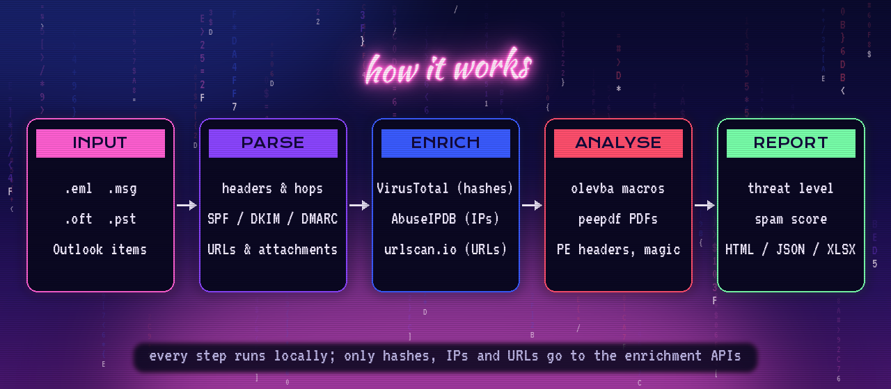

# Email Threat Analyzer

> **Closed source.** This page is an overview. The code and the Windows build are private. A live demo, a walkthrough, or read access to the source is available **on request**; see [Request access](#request-access).

A Windows tool I built while working as a SOC analyst to triage reported phishing emails. You drop in `.eml`, `.msg`, `.oft` or `.pst` files, and a few seconds later you get a verdict and a report, instead of ten minutes of copying headers, hashes and URLs between tabs.

## What it checks

- **Headers and routing:**
  - Every relay hop, with reverse DNS.
  - Sender IPs, checked against **AbuseIPDB**.
  - SPF, DKIM and DMARC results.
- **URLs:**
  - Extracted from the plain-text and HTML bodies and flagged by heuristics: lookalike domains, raw IPs, shorteners, odd TLDs.
  - Optionally submitted to **urlscan.io**.
- **Attachments:**
  - SHA-256 hashes looked up on **VirusTotal**. It rotates between two API keys to stay under free-tier rate limits.
  - The true file type from its magic bytes, so a renamed `.exe` doesn't pass as a `.pdf`.
  - PE headers on executables.
  - VBA macros extracted with **olevba**.
  - PDFs analysed with **peepdf**.
- **Verdict:**
  - A spam score and an overall threat level.
  - Recommended actions for the analyst.
- **Reports:** HTML, JSON and Excel for every email, so results can be attached to a ticket or loaded into a SIEM.

## Security and privacy decisions

- **Hostile content can't run in the report.** Everything taken from an email is HTML-escaped before it goes into the report, and URLs are defanged (`hxxp://evil[.]example`), so an analyst can't trigger a phishing page or script just by opening it.
- **No internal URLs leak to the internet.** urlscan.io submissions are unlisted, not public.
- **Keys stay on the analyst's machine.** API keys live only in a local config file and never in the code.
- **Only indicators leave the machine.** Hashes, IPs and URLs go to the enrichment APIs; email bodies and attachments are never uploaded.
- **Meant for an isolated VM.** Extracted attachments can be live malware, so the tool is designed to run inside an analysis VM.

## Built with

Python, Tkinter, `extract-msg`, Outlook COM (`pywin32`), `pefile`, `python-magic`, `oletools`, peepdf, pandas, and the VirusTotal, AbuseIPDB and urlscan.io APIs.

## Request access

Happy to show it. Email **zaynspublicprofiles@gmail.com** with the subject *"Email Threat Analyzer: access request"* and a line on who you are. Depending on what you need, I can:

- run a **live demo** over a call with a test phishing sample, or
- give you **read-only access** to the private source repository.

You can also reach me on [LinkedIn](https://www.linkedin.com/in/harbb/).

## License

© Zayn Al Abedine Harb. All rights reserved. The source code isn't published, and this overview grants no license to it.
